# PLANIFICACIÓN Y ARQUITECTURA DE SOFTWARE: WORD INVADERS

Este documento recoge el análisis arquitectónico, la validación lógica, el diseño de recursos y el plan de desarrollo por etapas para el videojuego educativo **WORD INVADERS**.

---

## 1. ANÁLISIS DEL PROYECTO

### 1.1 Resumen del Concepto
**WORD INVADERS** es un videojuego educativo 2D de estilo arcade y estética *pixel art* minimalista. El objetivo pedagógico es reforzar el vocabulario en inglés mediante el reconocimiento de la ortografía correcta de una palabra traducida desde el español.

A diferencia de un *Space Invaders* tradicional de acción frenética, **WORD INVADERS** prioriza la reflexión: no existen vidas ni límite de tiempo. El jugador observa una palabra en español, analiza una secuencia superior de letras en pantalla (que contiene la traducción correcta en orden, infiltrada con letras intrusas o "sobrantes") y utiliza su nave para disparar y eliminar **únicamente** las letras sobrantes.

### 1.2 Contradicciones, Ambigüedades y Decisiones de Diseño Detectadas

Durante el análisis de los requisitos iniciales se identificaron las siguientes ambigüedades, junto con la solución adoptada para mantener el proyecto sencillo y coherente:

1. **«Letras mezcladas» vs. «Las letras correctas respetan el orden original»**
   - **Ambigüedad:** Si las letras se desordenaran por completo (anagrama), al destruir las letras sobrantes las letras restantes quedarían desordenadas (ej. `P A L E P` → `P A L E` en vez de `A P P L E`).
   - **Resolución:** Las letras de la traducción correcta mantienen su **orden relativo original de izquierda a derecha**, y las letras sobrantes se **intercalan** entre ellas (por ejemplo, para `DOG`: `X D B O M G Z`). Así, al eliminar las intrusas (`X`, `B`, `M`, `Z`), se lee de izquierda a derecha `D O G`.

2. **Ambigüedad visual en letras repetidas o intrusas idénticas a las correctas**
   - **Problema:** Si la palabra es `APPLE` y la secuencia generada es `A P P P L E` (una `P` intrusa junto a las dos `P` correctas) o `A P L P E` (una `P` intrusa entre `L` y `E`), y el sistema marca internamente cuáles son "correctas" y cuáles "sobrantes" de forma fija:
     - En `A P P P L E`, el jugador no tiene forma visual ni lógica de saber cuál de las tres `P` fue marcada internamente como la intrusa. Si dispara a la primera `P` y el sistema había marcado la tercera como sobrante, perdería injustamente.
   - **Resolución:**
     1. **Restricción al generar letras sobrantes:** Las letras sobrantes se elegirán del alfabeto **excluyendo las letras que ya forman parte de la palabra en inglés** (salvo que la palabra use casi todo el abecedario, lo cual no ocurre en vocabulario normal).
     2. **Validación dinámica de respaldo (por si se permitieran sobrantes repetidas):** Si en algún caso hubiera dos letras idénticas adyacentes donde una es correcta y otra sobrante, cualquiera de las dos que reciba el disparo consumirá el rol de "sobrante" siempre que el orden final siga formando la palabra correcta. Sin embargo, **excluir del pool de intrusas las letras presentes en la traducción** elimina el 100% de la frustración del jugador y hace la regla transparente para un estudiante.

3. **Comportamiento de los espacios en expresiones compuestas (`HELLO WORLD`)**
   - **Ambigüedad:** ¿El espacio es un bloque destruible, un hueco vacío o un separador visual?
   - **Resolución:** Los espacios en expresiones compuestas **no son objetivos disparables**. Se representan como un hueco visual (o un guion bajo/separador inactivo no colisionable) que divide las palabras para que el jugador identifique claramente que se trata de dos o más palabras, y no se insertan letras sobrantes dentro del espacio separador si eso confunde la separación de palabras (o se mantienen claramente separadas por palabra).

4. **Movimiento de las letras en la parte superior**
   - **Ambigüedad:** No se especifica si las letras bajan como en *Space Invaders* o permanecen en la zona superior. Como "no existen vidas ni límite de tiempo", las letras **no deben descender hasta matar al jugador**.
   - **Resolución:** Las letras se ubican en la zona superior organizadas en una o dos filas (según la longitud total) con una ligera oscilación horizontal o estáticas en su cuadrícula. Al eliminar las letras sobrantes o terminar el nivel, las letras correctas pueden juntarse en el centro para mostrar claramente la palabra formada.

5. **Persistencia en el reinicio del nivel**
   - **Requisito:** "Si destruye una letra correcta, se registra un error y el nivel se reinicia" y "Los reinicios no generen secuencias diferentes".
   - **Resolución:** La secuencia generada para el nivel actual se guarda en memoria al iniciar el nivel. Si el jugador comete un error, se incrementa el contador de errores y se reconstruye exactamente la misma secuencia de objetos de letra sin volver a ejecutar el generador aleatorio.

---

## 2. REQUISITOS FUNCIONALES Y NO FUNCIONALES

### 2.1 Requisitos Funcionales (RF)
- **RF-01 (Carga de Glosario):** El sistema cargará las palabras desde un archivo local `glossary.json` que contendrá pares de palabras/expresiones (`es` y `en`).
- **RF-02 (Presentación del Nivel):** Se mostrará en pantalla la palabra en español a traducir, el número de nivel actual y el contador de errores acumulados.
- **RF-03 (Generación de Secuencia):** El juego generará una fila (o cuadrícula adaptativa) de bloques de letras que contiene las letras de la traducción en inglés en orden y un conjunto de letras sobrantes intercaladas.
- **RF-04 (Control de la Nave):** El jugador moverá la nave horizontalmente con el teclado (Flechas Izquierda/Derecha o teclas `A`/`D`) dentro de los límites de la pantalla.
- **RF-05 (Disparo):** El jugador disparará proyectiles verticales hacia arriba usando la `Barra Espaciadora` (con una cadencia controlada para evitar disparos infinitos simultáneos).
- **RF-06 (Destrucción de Letra Sobrante):** Si un proyectil impacta en una letra sobrante (`isExtra: true`), tanto el proyectil como la letra se destruyen.
- **RF-07 (Penalización por Letra Correcta):** Si un proyectil impacta en una letra necesaria (`isExtra: false`), se suma 1 al contador de errores, se muestra un aviso visual/sonoro breve y el nivel actual se reinicia con **exactamente la misma secuencia de letras**.
- **RF-08 (Victoria de Nivel):** Cuando el número de letras sobrantes activas llega a `0`, el nivel se da por completado y se avanza al siguiente tras una breve pausa de confirmación.
- **RF-09 (Fin del Juego):** Al completar todas las palabras del glosario de la partida, se muestra una pantalla de victoria final con el resumen de niveles completados y errores cometidos, permitiendo volver a jugar.

### 2.2 Requisitos No Funcionales (RNF)
- **RNF-01 (Tecnología):** HTML5, CSS3, JavaScript ES6+ modular, Phaser 3 y empaquetador Vite.
- **RNF-02 (Estética):** Estilo *pixel art* nítido (`pixelArt: true` en Phaser para desactivar el suavizado bilinear).
- **RNF-03 (Funcionamiento sin conexión):** Todo el código, librería Phaser, fuentes y recursos deben servirse localmente sin depender de CDNs externos en producción.
- **RNF-04 (Simplicidad de código):** Código legible y comentado en español, orientado a ser comprendido por un estudiante principiante.
- **RNF-05 (Intercambio de Recursos):** Capacidad de funcionar con gráficos generados por código (placeholders) y reemplazarlos automáticamente o con mínimo cambio al colocar los archivos PNG definitivos en la carpeta de `assets`.

---

## 3. REGLAS DEFINITIVAS DEL VIDEOJUEGO

1. **Inicio de partida:** El juego selecciona la lista de niveles desde el glosario. El contador de errores comienza en `0`.
2. **Objetivo en cada nivel:** Leer la palabra en español mostrada en el HUD y dejar en pantalla únicamente las letras que forman su traducción al inglés.
3. **Condición de acierto:** Disparar a una letra sobrante la elimina del escenario.
4. **Condición de fallo:** Disparar a una letra que forma parte de la traducción correcta incrementa el contador de errores (`+1`) y restaura todas las letras del nivel en las mismas posiciones en que aparecieron al inicio de ese nivel.
5. **Condición de avance:** Al destruir la última letra sobrante del nivel, se bloquean los disparos, se muestra visualmente la palabra limpia en inglés durante 1.5 segundos y se pasa al siguiente nivel.
6. **Sin presión temporal:** El jugador puede tardar todo el tiempo que necesite y cometer tantos errores como ocurran sin perder el progreso de los niveles anteriores.

---

## 4. ESTRATEGIA DE GENERACIÓN Y VALIDACIÓN DE LETRAS

Este es el núcleo lógico del juego. Para garantizar los 6 puntos solicitados sin fallos ni ambigüedades, se implementará un **Generador Basado en Ranuras (Slots)** con caché de nivel.

### 4.1 Estructura de Datos de cada Nodo de Letra
Cada elemento de la secuencia superior se define mediante un objeto de configuración antes de instanciarse en Phaser:

```javascript
{
  id: 0,              // Índice único en la secuencia (0, 1, 2...)
  char: 'A',          // Carácter a mostrar en mayúscula
  isExtra: false,     // false = letra de la traducción | true = letra sobrante
  isSpace: false      // true si representa un espacio separador entre palabras
}
```

### 4.2 Algoritmo Paso a Paso

1. **Normalización de la palabra objetivo:**
   - Se toma la traducción en inglés, se convierte a mayúsculas y se eliminan espacios al inicio y final (`trim()`). Ejemplo: `"apple"` → `"APPLE"`.
2. **Cálculo de la cantidad de letras sobrantes (`numExtras`):**
   - Depende de la longitud de la palabra (sin contar espacios) para equilibrar la pantalla:
     - **Palabras cortas (3 a 4 letras, ej. `DOG`, `CAT`, `BOOK`, `TREE`):** Se agregan entre `4` y `5` letras sobrantes (total en pantalla: 7 a 9 letras).
     - **Palabras medianas (5 a 7 letras, ej. `APPLE`):** Se agregan entre `4` y `5` letras sobrantes (total en pantalla: 9 a 12 letras).
     - **Palabras largas (8 o más letras, ej. `COMPUTER`, `HELLO WORLD`):** Se agregan entre `3` y `4` letras sobrantes (total en pantalla: 11 a 15 letras), evitando saturar el ancho de la pantalla.
3. **Selección del Pool de Letras Sobrantes (Prevención de Ambigüedad):**
   - Sea `ALPHABET = "ABCDEFGHIJKLMNOPQRSTUVWXYZ"`.
   - Se filtran de `ALPHABET` todas las letras que **ya existen** en la traducción objetivo.
   - *Ejemplo para `APPLE`:* Se excluyen `A, P, L, E`. Las letras sobrantes se eligen al azar del resto (`B, C, D, F, G, H...`).
   - **¿Qué pasa si el diseñador quisiera explícitamente que una letra sobrante pueda coincidir con una letra de la traducción?**
     - Si una letra sobrante coincide con una de la traducción (ej. meter una `P` extra en `APPLE`), existe el riesgo de que al jugador le queden varias `P` y no sepa cuál era la original y cuál la intrusa.
     - **Solución híbrida segura:**
       1. Por defecto, las letras sobrantes se toman de las letras **no presentes** en la palabra (100% libre de ambigüedad visual).
       2. Además, en el validador de colisión (`checkHit`), si por configuración existieran dos letras iguales donde una es `isExtra: true` y otra `isExtra: false`, se evalúa si al eliminar la letra impactada **la subsecuencia restante de letras en pantalla todavía puede formar la palabra objetivo en orden**. Si aún puede formarla, la letra impactada se acepta como sobrante e intercambia su bandera `isExtra` con la otra instancia. Así nunca se castiga injustamente al jugador.
4. **Intercalado respetando el orden original (Distribución en Ranuras):**
   - Una palabra de $N$ caracteres tiene $N + 1$ "ranuras" (antes de la primera letra, entre cada par de letras, y después de la última).
   - Se distribuyen las `numExtras` letras sobrantes aleatoriamente en esas $N + 1$ ranuras (máximo 2 letras sobrantes seguidas por ranura para que no queden todas amontonadas en un extremo).
   - Las letras correctas nunca cambian su orden entre sí.
5. **Tratamiento de casos especiales:**
   - **Palabras con letras repetidas (`APPLE`, `BOOK`, `TREE`):** Cada letra de la palabra base genera su propio nodo con `isExtra: false` e `id` único (`P` en índice 2 y `P` en índice 3). Ambas están protegidas.
   - **Palabras cortas (`DOG`, `CAT`) vs. Traducciones de distinta longitud (`PEZ` -> `FISH`, `SACAPUNTAS` -> `SHARPENER`):** La lógica de generación se basa exclusivamente en la longitud de la palabra en **inglés**, mientras que la palabra en **español** solo se renderiza como texto informativo en la interfaz (HUD).
   - **Expresiones con espacios (`HELLO WORLD`):** El carácter espacio `' '` se convierte en un nodo con `isSpace: true, isExtra: false`. En pantalla no dibuja una caja destruible ni tiene cuerpo de colisión física, sino que deja un espacio vacío visible (o pasa a una segunda fila si la expresión supera las 10 letras en total) para separar claramente las palabras.
6. **Garantía de reinicio idéntico (Requisito 2.6):**
   - `LevelManager` genera el arreglo `currentSequence` **únicamente** cuando se carga un nivel nuevo (`loadLevel(index)`).
   - Cuando el jugador dispara a una letra correcta, se llama a `restartCurrentLevel()`, el cual lee el arreglo `currentSequence` guardado en caché (haciendo una copia profunda de los objetos iniciales) y vuelve a colocar exactamente las mismas letras en las mismas posiciones.
7. **Verificación de victoria (Requisito 2.5):**
   - Cada vez que se destruye una letra sobrante, se filtra el grupo de letras activas en la escena:
     ```javascript
     const remainingExtras = activeLetters.filter(letter => letter.isExtra && letter.active);
     if (remainingExtras.length === 0) {
         handleLevelComplete();
     }
     ```
   - Esto garantiza que el nivel solo termine cuando hayan desaparecido **todas** las letras con `isExtra === true`.

---

## 5. ARQUITECTURA DEL SOFTWARE

Se propone una arquitectura limpia, modular y sin sobreingeniería, dividiendo las responsabilidades en **Configuración**, **Escenas de Phaser**, **Entidades (Objetos de juego)** y **Sistemas/Administradores lógicos (JS puro)**.

```mermaid
flowchart TD
    Main["main.js (Punto de entrada)"] --> Config["config/gameConfig.js"]
    Config --> Boot["BootScene (Carga de recursos)"]
    Boot --> Menu["MenuScene (Pantalla inicial)"]
    Menu --> Game["GameScene (Bucle principal)"]
    Game --> Victory["VictoryScene (Resumen final)"]
    Victory --> Menu

    Game --> LM["LevelManager (Estado de niveles y caché)"]
    LM --> GM["GlossaryManager (Lectura de glossary.json)"]
    LM --> WG["WordGenerator (Algoritmo de letras)"]

    Game --> Player["Player (Nave)"]
    Game --> Bullet["Bullet (Proyectil)"]
    Game --> LetterBox["LetterBox (Caja + Letra)"]
```



### 5.1 Escenas (`src/scenes/`)
1. **`BootScene.js` (Sistema de Carga de Recursos):**
   - **Responsabilidad:** Precargar el archivo `glossary.json`, las imágenes (`player.png`, `bullet.png`, `letter_tile.png`, `background.png`) y sonidos opcionales. Si algún archivo gráfico aún no existe, genera en memoria una textura *placeholder* con `Phaser.GameObjects.Graphics` bajo la misma clave (`key`). Así el juego nunca falla y permite reemplazar gráficos simplemente copiando los PNG en la carpeta correspondiente.
2. **`MenuScene.js` (Pantalla de Inicio):**
   - **Responsabilidad:** Mostrar el título **WORD INVADERS**, breves instrucciones en español ("Dispara a las letras sobrantes") y el botón o tecla (`ESPACIO` / `ENTER`) para comenzar.
3. **`GameScene.js` (Escena Principal de Juego):**
   - **Responsabilidad:** Instanciar la nave, el HUD (palabra en español, nivel actual, errores), el grupo de letras generado por `LevelManager`, gestionar las colisiones entre proyectiles y letras, y coordinar el reinicio o avance de nivel.
4. **`VictoryScene.js` (Pantalla Final):**
   - **Responsabilidad:** Mostrar la felicitación al completar todas las palabras del glosario, el total de errores cometidos y la opción de reiniciar la partida.

### 5.2 Clases y Entidades (`src/entities/`)
1. **`Player.js`:**
   - **Responsabilidad:** Encapsular el sprite de la nave del jugador, su cuerpo físico de Arcade Physics (limitado a los bordes del mundo), la lectura de teclas izquierda/derecha y la posición desde donde salen los disparos.
2. **`Bullet.js`:**
   - **Responsabilidad:** Representar el proyectil disparado por el jugador, su velocidad vertical hacia arriba y su autodestrucción al salir por el borde superior de la pantalla o al impactar una letra.
3. **`LetterBox.js`:**
   - **Responsabilidad:** Entidad compuesta (un `Container` o `Sprite` con un objeto `Text` superpuesto) que almacena sus propiedades lógicas (`id`, `char`, `isExtra`), su caja de colisión y sus efectos visuales al ser destruida o al revelar la palabra final.

### 5.3 Sistemas y Administradores (`src/managers/` y `src/systems/`)
1. **`GlossaryManager.js`:**
   - **Responsabilidad:** Recibir y validar los datos de `glossary.json`, verificar que todas las entradas tengan los campos `es` y `en` válidos, y entregar la lista de palabras para la partida.
2. **`WordGenerator.js`:**
   - **Responsabilidad:** Módulo de lógica pura (sin depender de Phaser) que recibe una palabra en inglés (ej. `"APPLE"`) y devuelve el arreglo de objetos `{ id, char, isExtra, isSpace }` siguiendo las reglas de la Sección 4. Al estar desacoplado de Phaser, es muy fácil de probar.
3. **`LevelManager.js`:**
   - **Responsabilidad:** Controlar en qué nivel se encuentra el jugador, llevar el conteo de errores, invocar a `WordGenerator` cuando se inicia un nivel nuevo y guardar en caché la secuencia actual (`currentSequenceCache`) para que los reinicios por error repitan exactamente la misma disposición de letras.

### 5.4 Configuración General (`src/config/`)
1. **`gameConfig.js` y `constants.js`:**
   - **Responsabilidad:** Definir la resolución base del lienzo (`800x600`), el escalado adaptativo (`Phaser.Scale.FIT` y centrado automático), la configuración de `pixelArt: true`, colores de la paleta, velocidades de la nave y proyectiles, y tamaños de fuente.

---

## 6. ESTRUCTURA DE CARPETAS PROPUESTA

```text
word-invaders/
├── index.html                  # Contenedor HTML5 principal
├── package.json                # Configuración de dependencias (Phaser, Vite)
├── vite.config.js              # Configuración de Vite para rutas relativas y build offline
├── PLANIFICACION.md            # Este documento de análisis y diseño
├── README.md                   # Guía general de instalación y uso
├── ASSETS.md                   # Especificación detallada de recursos gráficos
├── GAME_RULES.md               # Explicación de las reglas y mecánicas del juego
├── CODE_STRUCTURE.md           # Guía de la arquitectura explicada para principiantes
├── GLOSSARY_GUIDE.md           # Manual para añadir o editar palabras en el glosario
├── public/                     # Archivos estáticos copiados directamente al build
│   ├── data/
│   │   └── glossary.json       # Base de datos local de palabras (Español - Inglés)
│   └── assets/
│       ├── images/
│       │   ├── player.png      # Sprite de la nave del jugador
│       │   ├── bullet.png      # Sprite del proyectil
│       │   ├── letter_tile.png # Marco/bloque de fondo para cada letra
│       │   ├── background.png  # Fondo espacial pixel art (Opcional)
│       │   └── logo.png        # Logotipo del título (Opcional)
│       └── fonts/              # Fuente pixel art local (.ttf / .woff2) (Opcional)
└── src/                        # Código fuente ES6+
    ├── main.js                 # Punto de entrada que inicia la instancia de Phaser
    ├── style.css               # Estilos básicos para centrar el canvas en fondo oscuro
    ├── config/
    │   ├── constants.js        # Constantes globales (velocidades, colores, dimensiones)
    │   └── gameConfig.js       # Objeto de configuración de Phaser 3
    ├── managers/
    │   ├── GlossaryManager.js  # Lectura y validación del glosario JSON
    │   └── LevelManager.js     # Control de nivel actual, errores y caché de secuencia
    ├── systems/
    │   └── WordGenerator.js    # Algoritmo de generación de letras y validación
    ├── entities/
    │   ├── Player.js           # Clase de la nave del jugador
    │   ├── Bullet.js           # Clase del proyectil
    │   └── LetterBox.js        # Clase del bloque de letra interactivo
    └── scenes/
        ├── BootScene.js        # Carga de assets y generación de placeholders de respaldo
        ├── MenuScene.js        # Menú principal
        ├── GameScene.js        # Escena de juego e interfaz (HUD)
        └── VictoryScene.js     # Escena de juego completado
```

---

## 7. PLANIFICACIÓN DE RECURSOS GRÁFICOS E INVENTARIO DE SPRITES

Dado que crearás personalmente los sprites en estilo *pixel art*, el juego se diseñará con un **Sistema de Reemplazo Transparente**:
- En `BootScene.js`, el juego intentará cargar los archivos desde `public/assets/images/`.
- Mientras no hayas creado algún archivo (o si decides usar los generados por código al principio), el juego detectará su ausencia y dibujará automáticamente una textura *pixel art* provisional en memoria con el mismo nombre interno (`key`).
- Cuando guardes tu archivo `.png` en `public/assets/images/` con el nombre indicado, el juego usará tu sprite automáticamente sin tocar la lógica del juego.

### 7.1 Inventario y Especificaciones de los Sprites

| Recurso | Nombre de Archivo | Carpeta | Dimensiones (px) | Formato | Carácter | Descripción y Recomendaciones de Diseño |
| :--- | :--- | :--- | :--- | :--- | :--- | :--- |
| **Nave del Jugador** | `player.png` | `public/assets/images/` | **32 x 32 px** (o arte de 16x16 escalado x2) | PNG con transparencia | **Obligatorio** (con fallback provisional) | Vista frontal/superior tipo arcade clásico. Cañón apuntando hacia arriba en el centro (píxeles centrales X=15,16). |
| **Marco de Letra** | `letter_tile.png` | `public/assets/images/` | **40 x 40 px** | PNG con transparencia | **Obligatorio** (con fallback provisional) | Bloque o escudo espacial cuadrado donde se superpondrá la letra por código. Debe tener un centro de color uniforme y oscuro para que la letra blanca/clara se lea con alto contraste. |
| **Proyectil / Láser** | `bullet.png` | `public/assets/images/` | **8 x 16 px** | PNG con transparencia | **Opcional** (se puede generar con Phaser) | Disparo láser vertical sencillo. Colores brillantes (amarillo, cian o verde neón). |
| **Fondo Espacial** | `background.png` | `public/assets/images/` | **800 x 600 px** (o patrón repetible de **64 x 64 px**) | PNG | **Opcional** (se puede generar con Phaser) | Fondo oscuro (azul noche o negro espacial `#0d0d1a`) con estrellas sutiles de 1x1 o 2x2 px que no distraigan de las letras. |
| **Logo del Juego** | `logo.png` | `public/assets/images/` | **400 x 120 px** | PNG con transparencia | **Opcional** (se puede generar texto en Phaser) | Cartel con el texto "WORD INVADERS" en estilo retro para la pantalla de inicio (`MenuScene`). |

### 7.2 Elementos Generados Directamente mediante Phaser (Sin necesidad de imágenes)
1. **Las letras del abecedario (`A` - `Z`):** No necesitas dibujar 26 sprites distintos para las letras. Phaser renderizará el carácter de texto centrado encima de tu sprite `letter_tile.png`. Esto ahorra muchísimo trabajo artístico y asegura que todas las letras estén perfectamente alineadas.
2. **Proyectiles provisionales:** Un rectángulo de `6 x 14 px` generado con `Graphics` si no está `bullet.png`.
3. **Interfaz de Usuario (HUD):**
   - Panel superior con el nivel actual (`NIVEL 1/10`), contador de errores (`ERRORES: 0`) y recuadro destacado con la palabra en español (`TRADUCE: MANZANA`).
   - Mensajes flotantes de estado (`¡ERROR! REINICIANDO NIVEL...` y `¡CORRECTO!`).
4. **Efecto de explosión al destruir una letra:** Se generará con un emisor de partículas cuadradas simples (píxeles de 4x4 px) usando Phaser, manteniendo la estética retro sin requerir hojas de sprites de animación.

---

## 8. DEFINICIÓN DE LA DOCUMENTACIÓN DEL PROYECTO

Durante la fase de implementación se redactarán los siguientes 5 documentos en español, con un lenguaje claro, didáctico y pensado para un estudiante principiante:

1. **`README.md`**
   - Descripción general de **WORD INVADERS** y su propósito educativo.
   - Requisitos previos (Node.js instalado).
   - Instrucciones paso a paso para instalar dependencias (`npm install`), ejecutar el servidor de desarrollo (`npm run dev`) y compilar la versión final (`npm run build`).
   - Controles del juego.
2. **`ASSETS.md`**
   - Tabla detallada con todos los sprites, nombres exactos, rutas (`public/assets/images/`), resoluciones en píxeles y formato PNG con canal alfa.
   - Guía paso a paso de cómo reemplazar un gráfico provisional por un sprite propio creado en programas como Aseprite, Piskel o LibreSprite.
3. **`GAME_RULES.md`**
   - Explicación clara del flujo de una partida.
   - Reglas de victoria de nivel, qué ocurre al disparar a una letra sobrante y qué ocurre al disparar a una letra necesaria.
   - Ejemplos visuales con palabras concretas (ej. cómo pasa `X D B O M G` a `D O G`).
4. **`CODE_STRUCTURE.md`**
   - Mapa completo de las carpetas y archivos del proyecto.
   - Explicación sencilla de qué es una **Escena** en Phaser, qué es una **Entidad** y qué hace cada **Manager**.
   - Diagrama del flujo de datos desde que se lee `glossary.json` hasta que el jugador destruye una letra.
5. **`GLOSSARY_GUIDE.md`**
   - Explicación del formato JSON utilizado en `public/data/glossary.json`.
   - Reglas para agregar nuevas palabras o expresiones (uso de comillas, comas, caracteres permitidos, longitud máxima recomendada para que quepa bien en pantalla).
   - Ejemplos de plantillas listas para copiar y pegar.

---

## 9. PLAN DE DESARROLLO POR ETAPAS

El desarrollo se dividirá en **7 etapas incrementales**, diseñadas para que cada una sea verificable antes de pasar a la siguiente.

### Etapa 1: Configuración Base del Proyecto y Entorno Vite + Phaser
- **Objetivo:** Crear el esqueleto del proyecto con Vite y Phaser 3 funcionando en ventana centrada con configuración *pixel art*.
- **Archivos a crear/modificar:**
  - `package.json`, `vite.config.js`, `index.html`, `src/style.css`
  - `src/config/constants.js`, `src/config/gameConfig.js`, `src/main.js`
  - `src/scenes/BootScene.js` (básica)
- **Funcionalidades:** Inicialización del lienzo `800x600`, escalado automático `Phaser.Scale.FIT`, carga de una escena inicial de prueba.
- **Resultado esperado:** Al ejecutar `npm run dev`, se abre el navegador mostrando el lienzo negro centrado con un texto de prueba en estilo pixelado.
- **Pruebas:** Verificar que no existan errores en la consola del navegador (`F12`) y que al redimensionar la ventana el lienzo mantenga su proporción.

### Etapa 2: Glosario y Algoritmo de Generación de Letras (Lógica Pura)
- **Objetivo:** Implementar la carga de palabras y el generador de secuencias (`WordGenerator`) cubriendo todos los casos borde.
- **Archivos a crear/modificar:**
  - `public/data/glossary.json`
  - `src/managers/GlossaryManager.js`
  - `src/systems/WordGenerator.js`
  - `src/managers/LevelManager.js`
- **Funcionalidades:**
  - Lectura y validación del JSON.
  - Generación de nodos `{ id, char, isExtra, isSpace }` respetando el orden de la traducción e intercalando letras sobrantes sin ambigüedad.
  - Almacenamiento en caché de la secuencia del nivel actual para reinicios idénticos.
- **Resultado esperado:** El sistema genera secuencias válidas para palabras cortas (`DOG`), largas (`COMPUTER`), con letras repetidas (`APPLE`, `BOOK`, `TREE`) y con espacios (`HELLO WORLD`).
- **Pruebas:** Ejecutar pruebas en consola verificando que:
  1. Al filtrar los nodos con `isExtra: false`, la cadena resultante sea idéntica a la traducción en inglés.
  2. Al llamar a `restartLevel()`, la secuencia devuelta sea idéntica elemento por elemento a la inicial.

### Etapa 3: Sistema de Carga de Recursos y Gráficos Provisionales
- **Objetivo:** Configurar `BootScene` para cargar imágenes desde `public/assets/images/` o generar *placeholders* automáticos si los PNG aún no están presentes.
- **Archivos a crear/modificar:**
  - `src/scenes/BootScene.js`
  - `src/scenes/MenuScene.js`
- **Funcionalidades:** Creación dinámica de texturas de respaldo para `player`, `bullet` y `letter_tile`, y pantalla de menú principal funcional que lleva a `GameScene`.
- **Resultado esperado:** El menú de inicio se muestra correctamente y permite pasar a la escena de juego pulsando `ESPACIO` o `ENTER`.
- **Pruebas:** Iniciar el juego sin imágenes externas y comprobar que las texturas de respaldo se registran sin errores 404 bloqueantes.

### Etapa 4: Entidades del Jugador y Mecánica de Disparo
- **Objetivo:** Implementar la nave controlada por el jugador y el sistema de disparo vertical.
- **Archivos a crear/modificar:**
  - `src/entities/Player.js`
  - `src/entities/Bullet.js`
  - `src/scenes/GameScene.js` (parcial)
- **Funcionalidades:**
  - Movimiento horizontal fluido con cursores (`Izquierda`/`Derecha`) o `A`/`D`.
  - Colisión con los bordes izquierdo y derecho de la pantalla (`setCollideWorldBounds(true)`).
  - Disparo con `Barra Espaciadora` con enfriamiento (*cooldown* de ~300ms) y eliminación de balas al salir por arriba (`y < 0`).
- **Resultado esperado:** El jugador mueve la nave en la parte inferior y dispara proyectiles hacia la parte superior.
- **Pruebas:** Mover la nave hacia ambos extremos para comprobar que no se sale de la pantalla y disparar repetidamente verificando que las balas que salen por arriba se destruyen correctamente.

### Etapa 5: Renderizado de Letras, Colisiones y Reglas del Nivel
- **Objetivo:** Mostrar las letras en la parte superior, detectar impactos de proyectiles y aplicar las reglas de acierto, error (con reinicio idéntico) y victoria de nivel.
- **Archivos a crear/modificar:**
  - `src/entities/LetterBox.js`
  - `src/scenes/GameScene.js` (completo)
- **Funcionalidades:**
  - Distribución centrada de los bloques `LetterBox` en 1 o 2 filas según longitud de la secuencia.
  - Detección de colisión `Bullet` vs `LetterBox`.
  - Si `letter.isExtra === true`: destrucción individual de esa letra y del proyectil; comprobación de si quedan más letras sobrantes.
  - Si `letter.isExtra === false`: suma de 1 error, mensaje visual y reinicio inmediato del nivel usando la secuencia en caché.
  - Si no quedan letras sobrantes: mensaje de éxito y carga del siguiente nivel.
- **Resultado esperado:** El bucle jugable completo funciona de principio a fin.
- **Pruebas:**
  1. Disparar a una letra correcta y comprobar que el contador de errores sube en 1 y las letras reaparecen en el **mismo orden exacto**.
  2. Disparar solo a las letras sobrantes y comprobar que el nivel solo se completa al destruir la última letra sobrante.

### Etapa 6: Interfaz (HUD), Escena de Victoria y Pulido Visual
- **Objetivo:** Completar el HUD superior, la pantalla de fin de juego (`VictoryScene`) y pequeños efectos visuales (partículas al destruir letras y centrado de la palabra resuelta).
- **Archivos a crear/modificar:**
  - `src/scenes/GameScene.js` (HUD y feedback visual)
  - `src/scenes/VictoryScene.js`
- **Funcionalidades:**
  - Visualización clara de la palabra en español, progreso de nivel y contador de errores.
  - Transición a `VictoryScene` al superar la última palabra del glosario y botón para volver a jugar.
- **Resultado esperado:** El juego completo es navegable desde el menú inicial hasta la pantalla de victoria y reinicio.
- **Pruebas:** Completar un glosario corto de prueba (3 palabras) verificando el paso de `MenuScene` → `GameScene` (Niveles 1 a 3) → `VictoryScene` → `MenuScene`.

### Etapa 7: Documentación Completa y Verificación Offline
- **Objetivo:** Redactar los 5 documentos técnicos y de usuario solicitados y verificar el empaquetado final sin conexión.
- **Archivos a crear/modificar:**
  - `README.md`, `ASSETS.md`, `GAME_RULES.md`, `CODE_STRUCTURE.md`, `GLOSSARY_GUIDE.md`
- **Funcionalidades:** Documentación completa en español para estudiantes principiantes.
- **Resultado esperado:** Proyecto documentado y listo para usar o personalizar con los sprites definitivos.
- **Pruebas:** Ejecutar `npm run build` y `npm run preview` con la red desconectada para confirmar que todo funciona 100% offline.

---

## 10. PLAN DE PRUEBAS

Para validar la calidad del videojuego en cada etapa, se aplicará la siguiente matriz de pruebas funcionales:

| ID Prueba | Caso de Prueba | Entrada / Acción | Resultado Esperado |
| :--- | :--- | :--- | :--- |
| **CP-01** | Palabra corta | Nivel con `DOG` (`PERRO`) | Se generan 3 letras correctas en orden (`D-O-G`) y 4-5 letras sobrantes intercaladas. |
| **CP-02** | Palabra con letras repetidas | Nivel con `APPLE`, `BOOK` o `TREE` | Todas las letras repetidas de la traducción se conservan intactas; destruir una letra sobrante solo elimina esa instancia individual. |
| **CP-03** | Palabra larga | Nivel con `COMPUTER` | Los bloques de letras se ajustan al ancho de pantalla (o se dividen en 2 filas si superan el máximo por fila) sin salirse de los bordes. |
| **CP-04** | Expresión con espacio | Nivel con `HELLO WORLD` | El espacio se muestra como una separación visual entre ambas palabras y no puede ser destruido por los disparos. |
| **CP-05** | Disparo a letra correcta (Reinicio determinista) | Disparar a la `A` de `CAT` | El contador de errores sube en `+1`, el nivel se reinicia y la secuencia de letras mostrada es **idéntica** a la que había antes del fallo. |
| **CP-06** | Colisión única por proyectil | Disparar entre dos letras muy cercanas | El proyectil se desactiva en el primer fotograma de impacto y destruye **únicamente una** letra, nunca dos a la vez. |
| **CP-07** | Victoria de nivel | Destruir la última letra sobrante | Se desactivan los disparos adicionales, se resalta la traducción correcta formada y tras ~1.5s comienza el siguiente nivel. |
| **CP-08** | Reemplazo de sprites | Colocar `player.png` en `public/assets/images/` | El juego carga automáticamente la imagen PNG en lugar del gráfico provisional generado por código. |

---

## 11. RIESGOS Y SOLUCIONES TÉCNICAS

1. **Colisión simultánea de un proyectil con dos letras adyacentes en Phaser 3**
   - *Problema:* En Arcade Physics, si un proyectil toca el borde entre dos cajas en el mismo fotograma, el callback de `overlap` puede dispararse dos veces antes de que el proyectil se destruya.
   - *Solución sencilla:* Al inicio del callback `onBulletHitLetter(bullet, letter)`, verificar `if (!bullet.active || !letter.active) return;` e inmediatamente desactivar el cuerpo físico de la bala (`bullet.disableBody(true, true)`). Además, dejar un margen mínimo de separación (`padding` de 8 a 12 px) entre cada `LetterBox`.

2. **Frustración por letras sobrantes idénticas a las letras de la traducción**
   - *Problema:* Si la palabra es `TREE` y el generador añade una `E` sobrante, el jugador verá tres `E` y no sabrá cuál de ellas es la sobrante.
   - *Solución sencilla:* El generador selecciona las letras sobrantes de las letras del abecedario que **no** están presentes en la palabra objetivo. De este modo, toda letra que no pertenece a la traducción es identificable al 100% mediante el conocimiento del idioma, que es el objetivo educativo del juego.

3. **Desbordamiento horizontal en palabras largas o expresiones de varias palabras**
   - *Problema:* Una expresión como `GOOD MORNING` (12 caracteres + 4 letras sobrantes = 16 bloques) de 40 px cada uno más márgenes puede superar los 800 px de ancho.
   - *Solución sencilla:* Definir un límite máximo de `12` bloques por fila. Si la secuencia total supera los 12 elementos (o si es una expresión con espacio y conviene dividirla), el sistema distribuye automáticamente los bloques en **2 filas centradas** (por ejemplo, una palabra en la fila superior `Y = 140` y la segunda en `Y = 200`), dejando espacio libre suficiente para que el disparo pase entre las letras de la fila inferior o el jugador despeje primero las de abajo.

4. **Carga fallida si el usuario aún no ha creado todos los sprites PNG**
   - *Problema:* Si Phaser intenta cargar una imagen inexistente o vacía, la textura aparece como un cuadro negro con una línea verde (textura `__MISSING` de Phaser).
   - *Solución sencilla:* En `BootScene`, escuchar el evento `loaderror` de Phaser (o verificar `this.textures.exists(key)` en `create()`). Si una imagen aún no ha sido colocada en la carpeta `public/assets/images/`, el juego dibuja inmediatamente la textura de respaldo con el mismo nombre (`key`), permitiendo desarrollar y probar todo el juego antes o durante la creación de los sprites definitivos.

5. **Adaptación a diferentes resoluciones de pantalla y nitidez Pixel Art**
   - *Problema:* En monitores modernos el canvas puede verse pequeño o borroso al escalar.
   - *Solución sencilla:* Configurar `pixelArt: true` y `roundPixels: true` en `gameConfig.js` junto con el modo `scale: { mode: Phaser.Scale.FIT, autoCenter: Phaser.Scale.CENTER_BOTH, width: 800, height: 600 }`.

6. **Funcionamiento 100% sin conexión (Offline)**
   - *Problema:* Si se carga Phaser desde una CDN o fuentes desde Google Fonts, el juego fallará en aulas o equipos sin internet.
   - *Solución sencilla:* Instalar Phaser como dependencia local en `package.json` y configurar `base: './'` en `vite.config.js` para que todos los recursos empaquetados usen rutas locales relativas.
